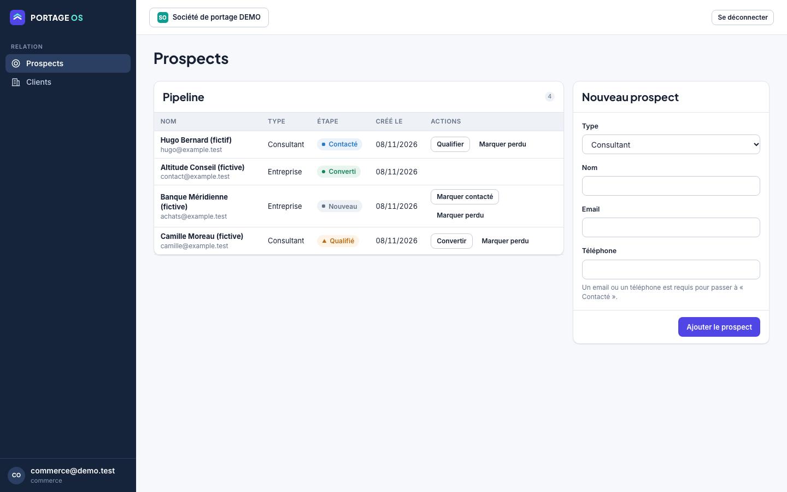

# PORTAGE OS

**Le poste de gestion du portage salarial français : CRM, contrats, CRA, facturation, paie via prestataire, compte d'activité et agents IA, dans un SaaS multi-tenant en marque blanche.**

> **Statut : socle en construction (Lot 0 terminé, Lot 1 amorcé). Ce n'est pas un produit utilisable en réel.**
> Aucune paie, DSN, facturation électronique, signature ni intégration bancaire n'est implémentée ou connectée. Rien n'a été validé juridiquement ni par un spécialiste paie. Voir [docs/STATUS.md](docs/STATUS.md) pour l'état exact, module par module.

|                     |                                                                                              |
| ------------------- | -------------------------------------------------------------------------------------------- |
| **Stack**           | TypeScript · Next.js 15 · NestJS · Prisma · PostgreSQL (RLS) · Playwright · Docker           |
| **Qualité**         | 13 tests domaine · 20 tests API/intégration (base réelle) · 14 tests E2E · TypeScript strict · CI |
| **En ligne (test)** | Voir [docs/DEPLOYMENT.md](docs/DEPLOYMENT.md) (Railway : API + PostgreSQL · Vercel : web)     |
| **Design**          | Claude Design importé (`packages/design-system`), clair et sombre, WCAG 2.2 AA visé          |
| **Données**         | 100 % fictives (jeux de démonstration isolés des workflows réels)                            |



## Sommaire
[Ce qui existe](#ce-qui-existe) · [Ce qui n'existe pas](#ce-qui-nexiste-pas-encore) · [Architecture](#architecture) · [Sécurité](#sécurité) · [Qualité et tests](#qualité-et-tests) · [Démarrer en local](#démarrer-en-local) · [Déploiement](#déploiement) · [Structure du dépôt](#structure-du-dépôt) · [Documentation](#documentation)

## Ce qui existe
| Domaine | Contenu réel | Preuve |
|---|---|---|
| Identité et tenants | Login JWT 15 min, mots de passe scrypt, appartenances multi-sociétés, 12 rôles RBAC, limiteur d'échecs de login | `apps/api/test/tenant-isolation.test.ts` |
| Isolation | RLS PostgreSQL par tenant, rôles relus en base à chaque requête, IDOR = 404, test de mutation RLS | idem + [ADR 0001](docs/adr/0001-rls-tenant-isolation.md) |
| Audit | Journal append-only (triggers), écrit pour les actions critiques | [ADR 0003](docs/adr/0003-append-only-audit.md) |
| Domaine pur | Montants Decimal, TVA par ligne, paramètres réglementaires datés/sourcés/approuvés, journal comptable équilibré avec contrepassation, numérotation sans trou, machine d'état | `packages/domain/test` |
| CRM prospects | Pipeline nouveau → contacté → qualifié → converti / perdu, préconditions, concurrence optimiste, audit | `apps/api/test/prospects.test.ts`, E2E |
| Clients | Entreprises clientes (nom, SIREN), validation | tests API + E2E |
| Front | Coque du design, login, prospects, clients, audit ; BFF avec cookie httpOnly ; clair/sombre ; mobile | `apps/web/e2e` |

## Ce qui n'existe pas encore
Contrats et signatures, missions, CRA et absences, notes de frais, facturation électronique, banque et recouvrement, **paie et DSN**, compte d'activité, RH, conformité (règles légales à saisir depuis des sources officielles), comptabilité, pilotage, portails consultant/client/partenaires, administration SaaS, agents IA et RAG, MFA/SSO, invitations, workers durables, webhooks. Chaque ligne figure dans la [matrice d'implémentation](docs/IMPLEMENTATION_MATRIX.md) avec son statut.

## Architecture
```
Navigateur ──► Vercel (Next.js : UI + BFF /api/session, /api/proxy) ──► Railway : API NestJS ──► PostgreSQL (RLS)
                    cookie httpOnly, liste blanche de routes, contrôle d'Origin    rôle portage_app, audit append-only
```
Monorepo pnpm : `apps/api`, `apps/web`, `packages/domain` (règles pures), `packages/design-system`. Détail : [docs/ARCHITECTURE.md](docs/ARCHITECTURE.md), décisions : [docs/adr](docs/adr).

## Sécurité
Tenant imposé côté serveur, jamais le rôle du front. Aucun secret dans le dépôt. Limites connues (pas de MFA, pas de refresh de token, `User`/`Membership` hors RLS, limiteur en mémoire) : [docs/SECURITY.md](docs/SECURITY.md).

## Qualité et tests
```bash
pnpm test                                   # domaine + API (Postgres requis)
pnpm -F @portage/web test:e2e               # Playwright, ports dédiés 4310/4311
```
La CI ([.github/workflows/ci.yml](.github/workflows/ci.yml)) exécute typecheck, build, tests, seed démo et E2E sur une base PostgreSQL jetable. Plan : [docs/TEST_PLAN.md](docs/TEST_PLAN.md).

## Démarrer en local
Prérequis : Node 22+, pnpm 10, Docker.
```bash
cp .env.example .env              # renseigner des valeurs LOCALES (aucun secret réel)
docker compose up -d postgres
pnpm install
pnpm migrate                      # migrations (propriétaire)
APP_DB_PASSWORD=... ./scripts/db-roles.sh   # active le rôle applicatif portage_app
DEMO_PASSWORD=... pnpm seed       # tenant « demo » fictif (refusé si APP_ENV=production)
pnpm -F @portage/domain build && pnpm -F @portage/api build
node apps/api/dist/main.js        # API :3001 (JWT_SECRET, APP_DATABASE_URL requis)
pnpm -F @portage/web dev          # web :3000
```

## Déploiement
Railway (API + PostgreSQL) et Vercel (web) : procédure, variables et vérifications dans [docs/DEPLOYMENT.md](docs/DEPLOYMENT.md). Alternative européenne documentée dans le même fichier.

## Structure du dépôt
```text
apps/api              API NestJS (auth, tenant, RBAC, audit, prospects, clients) + Prisma
apps/web              Next.js (UI, BFF), tests E2E Playwright
packages/domain       Règles métier pures et testées
packages/design-system  Tokens et CSS importés de Claude Design + sources des artboards
docs/                 Architecture, ADR, sécurité, déploiement, matrice, statut, captures
.github/              CI, modèles de PR/issues, CODEOWNERS, Dependabot
```

## Documentation
[STATUS](docs/STATUS.md) · [IMPLEMENTATION_MATRIX](docs/IMPLEMENTATION_MATRIX.md) · [PRODUCT_SCOPE](docs/PRODUCT_SCOPE.md) · [ARCHITECTURE](docs/ARCHITECTURE.md) · [DOMAIN_RULES](docs/DOMAIN_RULES.md) · [DESIGN_HANDOFF](docs/DESIGN_HANDOFF.md) · [INTEGRATIONS](docs/INTEGRATIONS.md) · [SECURITY](docs/SECURITY.md) · [TEST_PLAN](docs/TEST_PLAN.md) · [DEPLOYMENT](docs/DEPLOYMENT.md) · [OPERATIONS](docs/OPERATIONS.md) · [ENGINEERING](docs/ENGINEERING.md) · [DECISIONS](docs/DECISIONS.md)

> Aucune licence n'est accordée : tous droits réservés tant qu'aucune licence n'est ajoutée.
