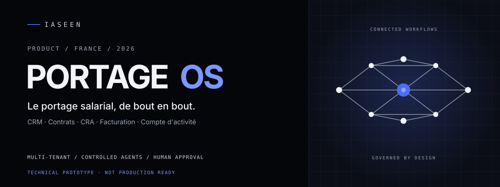
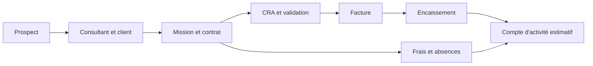
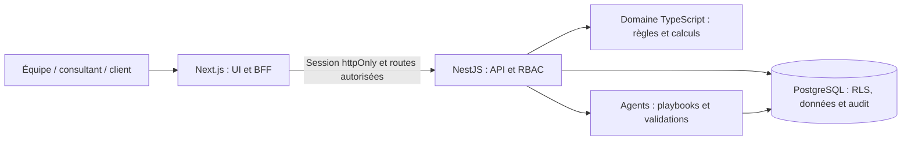

# PortageOS

<!-- portfolio-summary:start -->



> **Le portage salarial, de bout en bout.**
>
> Une plateforme SaaS pour les sociétés de portage salarial françaises : CRM, consultants, missions, contrats, CRA, facturation, compte d'activité et workflows assistés.
>
> **Statut : prototype technique. Ne pas utiliser en production.**
>
> [État vérifié](docs/STATUS.md) · [Fonctionnalités prévues](docs/PRODUCT_SCOPE.md) · [Architecture](docs/ARCHITECTURE.md) · [Suivi d'implémentation](docs/IMPLEMENTATION_MATRIX.md)

[](https://github.com/yassineaqejjaj/PortageOS/actions/workflows/ci.yml)

<!-- portfolio-summary:end -->

**Un espace pour gérer l'activité. Des données séparées par société. Des actions que les équipes peuvent vérifier.**

PortageOS réunit les étapes du portage salarial dans un même produit. Son objectif : réduire les échanges dispersés entre commerce, opérations, RH et finance, et donner aux consultants comme aux entreprises clientes un espace adapté à leurs droits.

**À lire avant toute utilisation :** le dépôt n'est pas un logiciel de paie prêt à l'emploi. Aucune paie ni DSN n'est produite, aucun prestataire de facturation électronique, de banque ou de signature électronique n'est connecté, et aucune règle juridique n'a été validée par un professionnel. Les données de démonstration sont fictives. Voir [docs/STATUS.md](docs/STATUS.md).

## 01. Pourquoi PortageOS ?

| Situation courante | Ce que PortageOS cherche à apporter |
|---|---|
| Les données des prospects, consultants et clients sont réparties entre plusieurs outils | Une chaîne CRM → dossier → mission → CRA → facture |
| Les validations de temps et de frais passent par des échanges manuels | Des workflows explicites avec des rôles et un historique |
| La finance perd du temps à relier les montants aux opérations | Un registre et un compte d'activité **estimatif** avec les mouvements associés |
| Les utilisateurs voient trop de données ou pas les bonnes | Des espaces back-office, consultant et client, avec contrôle des droits côté serveur |
| Une IA pourrait agir sans preuve ni accord | Des propositions enregistrées et une validation humaine avant les actions sensibles |

### À qui s'adresse la plateforme ?

| Profil | Expérience cible |
|---|---|
| **Direction / opérations** | Vue sur les consultants, missions, contrats et tâches à traiter |
| **Commerce** | Suivi des prospects et des entreprises clientes |
| **RH / finance / conformité** | Vérifications, approbations, flux financiers, audit |
| **Consultant porté** | CRA, frais, absences, informations liées à son activité |
| **Entreprise cliente** | Consultation et validation des CRA de ses missions |
| **Opérateur SaaS** | Gestion de plusieurs sociétés de portage, sans mélange de données |

## 02. Le parcours métier



Le métier reste la référence : les étapes sont liées, les montants sont calculés côté serveur et les décisions importantes peuvent être retracées.

### Capture de l'interface


*Écran issu du développement. Il ne correspond pas à une solution de facturation électronique connectée à une plateforme agréée.*

Le design system, provenant de Claude Design, se trouve dans [`packages/design-system`](packages/design-system). Il comprend les tokens, la coque de navigation et les thèmes clair/sombre ; tous les composants prévus ne sont pas encore réalisés.

## 03. Ce qui est réellement implémenté

Le tableau qui suit reprend les fonctionnalités présentes dans le code et leurs preuves. **Chaque module reste partiel** : une route, un test ou un écran ne suffit pas à établir qu'un processus est opérationnel chez un client.

| Domaine | Contenu réel | Preuve |
|---|---|---|
| Identité et tenants | Login JWT 15 min, mots de passe scrypt, appartenances multi-sociétés, 12 rôles RBAC, limiteur d'échecs de login | `apps/api/test/tenant-isolation.test.ts` |
| Isolation | RLS PostgreSQL par tenant, rôles relus en base à chaque requête, IDOR = 404, test de mutation RLS | idem + [ADR 0001](docs/adr/0001-rls-tenant-isolation.md) |
| Audit | Journal append-only (triggers), écrit pour les actions critiques | [ADR 0003](docs/adr/0003-append-only-audit.md) |
| Domaine pur | Montants Decimal, TVA par ligne, paramètres réglementaires datés/sourcés/approuvés, journal comptable équilibré avec contrepassation, numérotation sans trou, machine d'état | `packages/domain/test` |
| CRM prospects | Pipeline nouveau → contacté → qualifié → converti / perdu, préconditions, concurrence optimiste, audit | `apps/api/test/prospects.test.ts`, E2E |
| Clients | Entreprises clientes (nom, SIREN), validation | tests API + E2E |
| Consultants | Dossier, checklist d'onboarding (6 tâches manuelles), activation conditionnée, création à la conversion d'un prospect | `billing-chain.test.ts` |
| Missions | Consultant actif × client, TJM, TVA saisie, dates | idem |
| CRA | Saisie contrôlée (½/1 jour, période, dates), machine d'état, portails consultant et client cloisonnés (client sans donnée salariale), preuve en audit, verrouillage | idem + `e2e/chain.spec.ts` |
| Facturation | Facture depuis CRA validé (Decimal), numérotation sans trou, émission, encaissements partiels, annulation par contrepassation. **Non connectée** à une plateforme agréée | idem |
| Paramètres réglementaires | Catalogue daté, sourcé, approuvé à quatre yeux, immuable ; aucune valeur légale livrée | `modules2.test.ts` |
| Notes de frais | Barème kilométrique paramétré (refus s'il manque), plafond repas signalé, justificatifs (référence), doublons, séparation des tâches, remboursement + journal | idem + E2E |
| Avoirs | Avoir total numéroté (AV), contrepassation | idem |
| Compte d'activité | Relevé mensuel **estimatif** détaillé, sourcé, jamais présenté comme un salaire | idem + E2E |
| Contrats | Modèles versionnés immuables, variables strictes, signature **déclarée** (non qualifiée) | idem + E2E |
| Absences et congés | Décompte en jours ouvrés (fériés = paramètres approuvés), solde par ajustements RH motivés, approbation sans auto-validation, annulation, cohérence avec le CRA | `leaves.test.ts` + E2E |
| Agents | 6 agents (Payroll indisponible), outils typés lecture/écriture, playbooks **déterministes**, propositions approuvées par des humains (1 ou 2 niveaux), budgets, coupe-circuit, journal d'appels. **Aucun LLM connecté** | `agents.test.ts` + E2E |
| Notifications | In-app (CRA, frais, absences, support), destinataires cloisonnés, préférences par type. **E-mail non connecté** | `support-notifications.test.ts` + E2E |
| Support | Tickets, réponses, notes internes invisibles du demandeur, workflow, assignation, recherche, modèles | idem + E2E |
| Pilotage | KPI définis et sourcés (CA, encaissements, frais de gestion, créances, DSO, cohortes, conversion…), export CSV audité. Pas de MRR, marges ni prévisions | `pilotage.test.ts` (calculs vérifiés à la main) + E2E |
| Registre financier | Journal append-only équilibré (trigger en base), balance, réconciliation créances ↔ factures | idem |
| Front | Coque du design, login, prospects, clients, audit ; BFF avec cookie httpOnly ; clair/sombre ; mobile | `apps/web/e2e` |

Les statuts détaillés par backend, UI, intégration et tests figurent dans [IMPLEMENTATION_MATRIX.md](docs/IMPLEMENTATION_MATRIX.md). Cette matrice est la source à consulter pour distinguer les écrans opérationnels, les règles codées et les dépendances non connectées.

## 04. L'IA, sous contrôle

La cible produit prévoit des agents d'assistance pour l'intégration des consultants, les contrats, les opérations, la finance et l'espace consultant, ainsi qu'un agent lié à la paie.

**Ce qui existe :** six rôles d'agents enregistrés, des outils typés, des playbooks déterministes, un journal d'appels, des budgets d'exécution, un coupe-circuit et des propositions soumises à une ou deux validations humaines. Les actions sont exécutées avec les droits de l'approbateur. L'agent Payroll est indisponible.

**Ce qui reste à construire :** connexion à un LLM, compréhension des demandes en langage naturel, orchestration autonome, RAG documentaire avec sources, évaluations et suivi de la qualité des modèles. Aucun de ces éléments n'est aujourd'hui opérationnel. Il serait donc inexact de présenter le prototype comme une plateforme d'agents IA autonomes.

**Principe de conception :** l'IA peut proposer ; les règles métier, les permissions et les humains restent responsables de l'exécution.

## 05. Architecture et choix techniques



| Couche | Technologies |
|---|---|
| Interface | Next.js 15, TypeScript, responsive, thèmes clair et sombre |
| API | NestJS, Prisma, JWT, autorisations |
| Métier | TypeScript, montants Decimal, machines d'état, paramètres datés |
| Données | PostgreSQL, isolation RLS par tenant, registre et journal append-only |
| Qualité | Tests de domaine, API sur base réelle, Playwright E2E, CI GitHub |
| Environnement de test | Vercel pour le web, Railway pour l'API et PostgreSQL |

Le dépôt est un monorepo **pnpm** organisé autour de `apps/api`, `apps/web`, `packages/domain` et `packages/design-system`. Les détails et les décisions sont documentés dans [ARCHITECTURE](docs/ARCHITECTURE.md) et [ADR](docs/adr).

### Sécurité et limites

L'identité du tenant et les rôles sont vérifiés côté serveur, jamais déduits du front. Le code contient des contrôles d'isolation, des vérifications anti-accès hors périmètre et un audit des actions critiques. **Ce socle n'est pas une validation de sécurité pour une mise en production.** MFA/SSO, gestion avancée des sessions et plusieurs mesures d'exploitation restent à ajouter. Voir [SECURITY](docs/SECURITY.md).

## 06. Qualité et état du projet

<!-- technical-verification:start -->

| Vérification documentée au 8 novembre 2026 | Nombre |
|---|---:|
| Tests de domaine | **29** |
| Tests API / intégration sur PostgreSQL | **83** |
| Scénarios navigateur Playwright | **24** |

<!-- technical-verification:end -->

La CI couvre typecheck, build, tests, seed fictif et E2E sur une base PostgreSQL temporaire. Ces tests **ne remplacent pas** une validation juridique, une recette de paie, un test de sécurité externe ni un essai auprès d'une société de portage.

```bash
pnpm test
pnpm -F @portage/web test:e2e
```

Voir le [plan de tests](docs/TEST_PLAN.md) et le [statut vérifié](docs/STATUS.md).

## 07. Démarrage local

Prérequis : Node.js 22 recommandé, pnpm 10 et Docker.

```bash
git clone https://github.com/yassineaqejjaj/PortageOS.git
cd PortageOS

cp .env.example .env
pnpm install
docker compose up -d postgres
pnpm migrate

# Configurer uniquement des identifiants locaux et fictifs.
APP_DB_PASSWORD=... ./scripts/db-roles.sh
DEMO_PASSWORD=... pnpm seed

pnpm -F @portage/domain build
pnpm -F @portage/api build
node apps/api/dist/main.js

# Dans un autre terminal :
pnpm -F @portage/web dev
```

Web : `http://localhost:3000` · API : `http://localhost:3001`.

Avant le lancement, renseigner les variables requises dans `.env`, dont les paramètres d'accès à la base et `JWT_SECRET`. Le seed de démonstration refuse `APP_ENV=production`. Ne jamais charger de données personnelles réelles dans cet environnement.

## 08. Déploiement de test

| Composant | Service | État |
|---|---|---|
| Web | [portageos.vercel.app](https://portageos.vercel.app) | Environnement de test |
| API | [Endpoint santé Railway](https://api-production-3d59.up.railway.app/health) | `/health` vérifié |
| Base | PostgreSQL Railway privé | Migrations et rôle applicatif testés |

L'environnement distant dispose d'une **base vide**, sans compte de démonstration en ligne. Le parcours authentifié complet, la restauration, la charge, la résidence UE et la mise en service réelle ne sont pas validés. Consulter le [guide de déploiement](docs/DEPLOYMENT.md).

## 09. Prochaines étapes

| Priorité produit | Ce qu'il reste à réaliser |
|---|---|
| **Parcours métiers complets** | Documents, avenants, workflows transversaux, portails et administration |
| **Intégrations françaises** | Signature, facturation électronique, banque, paie externalisée et DSN |
| **Conformité** | Règles françaises datées, contrôles et validation par spécialistes |
| **IA générative** | Modèles connectés, orchestration, RAG, évaluation et observabilité |
| **SaaS exploitable** | SSO/MFA, workers durables, supervision, reprise après incident et exigences de sécurité |

Cette feuille de route exprime **l'objectif du produit**, pas des fonctionnalités déjà livrées.

## 10. Le dépôt

```text
apps/
  api/                   NestJS, Prisma, authentification, API et services
  web/                   Next.js, portails, BFF et Playwright
packages/
  domain/                Règles métier, montants et états
  design-system/         Tokens et styles Claude Design
docs/
  assets/                Bannière et identité visuelle IASEEN
  screenshots/           Captures d'écran de développement
  adr/                   Décisions techniques
  STATUS.md              État réel du produit
  IMPLEMENTATION_MATRIX.md
.github/                 Intégration continue et fichiers de contribution
```

### Documentation

[État](docs/STATUS.md) · [Périmètre](docs/PRODUCT_SCOPE.md) · [Matrice](docs/IMPLEMENTATION_MATRIX.md) · [Architecture](docs/ARCHITECTURE.md) · [Règles métier](docs/DOMAIN_RULES.md) · [Design](docs/DESIGN_HANDOFF.md) · [Intégrations](docs/INTEGRATIONS.md) · [Sécurité](docs/SECURITY.md) · [Tests](docs/TEST_PLAN.md) · [Déploiement](docs/DEPLOYMENT.md) · [Opérations](docs/OPERATIONS.md) · [Engineering](docs/ENGINEERING.md) · [Décisions](docs/DECISIONS.md)

---

**PortageOS** · Un projet [IASEEN](https://iaseen.com). Identité visuelle : **IASEEN Constellation**.

**Licence :** aucune licence open source n'a été accordée pour ce dépôt. Tous droits réservés sauf mention contraire.
